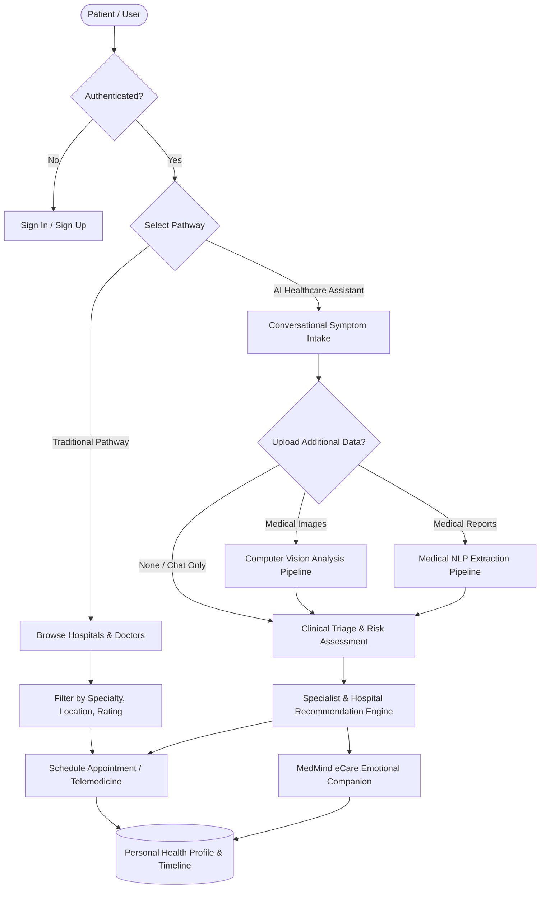
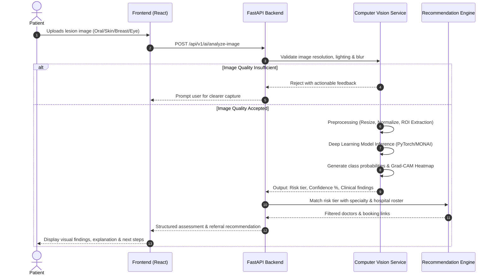
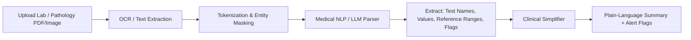
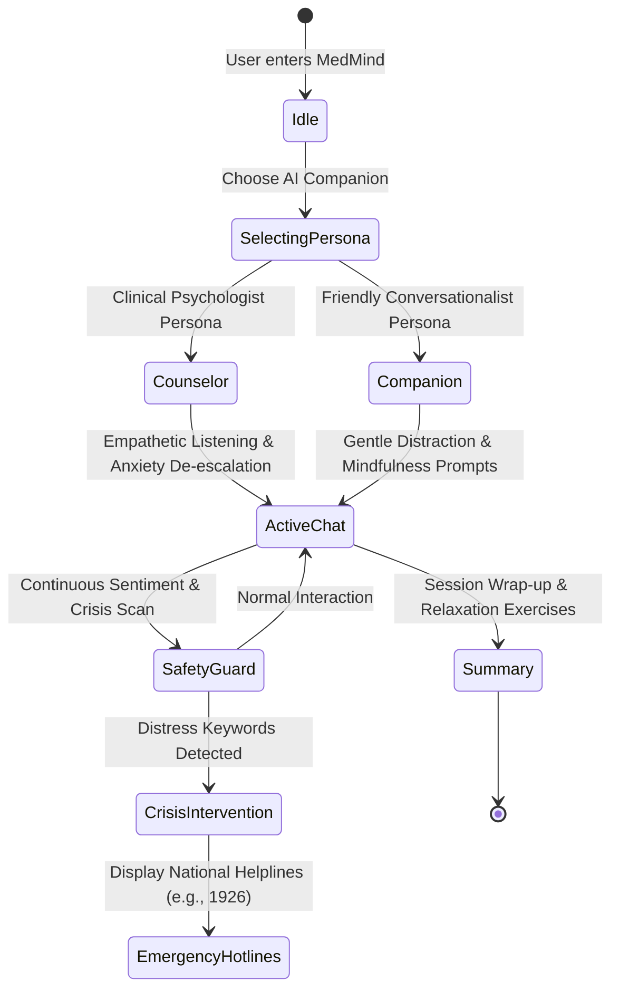

# MedDoc — System Workflow & Implementation Guide

**Project:** MedDoc  
**Team Name:** CreativeX Technology  
**University:** ICBT Campus  
**Track:** University Track — Innodata AI Catalyst '26  
**Document:** `docs/Workflow.md`  

---

## 1. High-Level System Workflow

MedDoc operates on a **dual-entry user experience**, unifying traditional clinical logistics (hospital search, specialist directory, booking) with an intelligent **multi-modal AI clinical decision support pipeline** (Conversational triage, Computer Vision lesion analysis, and Medical NLP document summarization).



---

## 2. End-to-End User Experience Workflows

### 2.1 Pathway A: Direct Appointment & Telemedicine Flow
1. **User Discovery:** Patient browses participating hospitals, clinics, and verified specialist doctors.
2. **Filtering & Comparison:** User filters by medical discipline, geolocation, consultation fees, and patient satisfaction ratings.
3. **Slot Booking:** Patient selects an available date and time slot (in-person physical consultation or remote telemedicine video call).
4. **Confirmation & Profile Linking:** Appointment record is linked to the user's digital health timeline with SMS/Email notifications.

### 2.2 Pathway B: AI Healthcare Assistant & Clinical Triage Flow
1. **Natural Language Dialogue:** Patient describes symptoms in their own words via text or Gemini-powered live voice.
2. **Dynamic Clinical Inquiry:** The AI assistant asks structured follow-up questions (symptom onset, progression, severity 1-10, pain triggers, past medical history).
3. **Multi-Cancer Visual Screening (Optional):** If symptoms involve visible skin, oral, breast, or eye irregularities, the user uploads high-resolution photos.
4. **Report Summarization (Optional):** If previous laboratory or pathology reports exist, the user uploads PDF/image documents for automated terminology simplification.
5. **AI Risk Assessment Delivery:** The platform presents a structured, non-diagnostic risk stratification (Low / Moderate / Elevated Risk) with plain-language explanations.
6. **Smart Referral:** Automatically connects the patient to the most relevant medical specialist discipline (e.g., Oral & Maxillofacial Surgeon, Dermatologist, Oncologist) with nearest hospital options.

---

## 3. Specialized AI Pipeline Workflows

### 3.1 Medical Computer Vision Pipeline (Oral, Skin, Breast, Eye)



#### Detailed Pipeline Stages:
1. **Input Quality Check:** Evaluates lighting conditions, focus blur, and anatomical region alignment.
2. **Preprocessing:** Standardized normalization, color equalization, and Region-of-Interest (ROI) segmentation.
3. **Inference:** Classification through deep convolutional / vision transformer backbones tailored for dermatological and oral pathology patterns.
4. **Explainability Layer:** Generates localization heatmaps (Grad-CAM) highlighting regions influencing the model's confidence.
5. **Clinical Disclaimer:** Mandatory prompt reiterating that the assessment is decision support and requires validation by a qualified medical professional.

---

### 3.2 Medical Report Interpretation & NLP Pipeline



1. **Document Ingestion:** Accepts lab reports, biopsy notes, and blood test panels in PDF or image format.
2. **Text & Entity Extraction:** Extracts biomedical entities, numeric lab values, and out-of-range flags.
3. **Patient-Centric Simplification:** Translates complex clinical terminology into clear, accessible language without altering diagnostic implications.
4. **Physician Intake Summary:** Generates a concise summary bullet list ready for the consulting doctor during the subsequent visit.

---

### 3.3 MedMind eCare Emotional Wellness Workflow

Waiting for cancer screenings or biopsy results is mentally demanding. MedMind eCare bridges the anxiety gap:



---

## 4. Implementation & Deployment Workflow

### 4.1 Development Lifecycle
1. **Local Setup:** Development using Python 3.11+ virtual environment, FastAPI, and modular routers.
2. **Linting & Code Quality:** Code analyzed with PEP 8 standards, Pydantic data validation schemas, and automated pytest suites.
3. **Containerization:** Packaged with multi-stage Docker builds to ensure consistent runtime environments across local, staging, and production environments.
4. **CI/CD Integration:** Automated GitHub Actions workflows for continuous integration, schema validation, and deployment.

### 4.2 Application Architecture Diagram

```mermaid
graph TB
    subgraph Client Layer
        Web[React / TypeScript SPA]
        Mobile[Responsive PWA / Mobile Web]
    end

    subgraph API Gateway & Backend
        FastAPI[FastAPI Application Server]
        AuthModule[Supabase Auth / JWT Validation]
        TriageRouter[/api/v1/ai/triage]
        ImageRouter[/api/v1/ai/analyze-image]
        ReportRouter[/api/v1/ai/analyze-report]
        BookingRouter[/api/v1/appointments]
    end

    subgraph AI Model Services
        PyTorchEngine[PyTorch / MONAI CV Inference]
        NLPEngine[Hugging Face / LLM Report Parser]
        VoiceEngine[Gemini Live API Voice Bridge]
    end

    subgraph Data & Storage
        Postgres[(PostgreSQL Database)]
        CloudStorage[(Secure Document & Image Storage)]
    end

    Web --> FastAPI
    Mobile --> FastAPI
    FastAPI --> AuthModule
    FastAPI --> TriageRouter
    FastAPI --> ImageRouter
    FastAPI --> ReportRouter
    FastAPI --> BookingRouter

    ImageRouter --> PyTorchEngine
    ReportRouter --> NLPEngine
    TriageRouter --> VoiceEngine

    FastAPI --> Postgres
    FastAPI --> CloudStorage
```

---

## 5. Security, Privacy & Compliance Workflow
- **Data in Transit:** Enforced HTTPS / TLS 1.3 encryption across all communication endpoints.
- **Data at Rest:** Encrypted health records and uploaded images in isolated cloud storage with signed expiring URLs.
- **Role-Based Access Control (RBAC):** Distinct permissions separating Patient, Doctor, and Administrative boundaries.
- **Audit Logging:** Every access to medical imagery and clinical notes is securely logged for traceability.
